<!-- ========================================== -->
<!-- 01: HERO & IDENTITY PANEL                  -->
<!-- ========================================== -->

 

<!-- ========================================== -->
<!-- 02: CAPABILITIES & ARCHITECTURE DOMAINS     -->
<!-- ========================================== -->

 

<!-- ========================================== -->
<!-- 03: TECHNICAL ARSENAL & TELEMETRY          -->
<!-- ========================================== -->

 

<!-- ========================================== -->
<!-- 04: FEATURED EXECUTION & VERIFIED WORK     -->
<!-- ========================================== -->

 

<!-- ========================================== -->
<!-- 05: TRANSMISSION GATEWAY & DIRECT CHANNELS -->
<!-- ========================================== -->

 

<!-- ========================================== -->
<!-- QUICK TEXT LINKS & METRICS NAVIGATION      -->
<!-- ========================================== -->

  <a href="https://github.com/aadithya200718"><strong>GitHub Profile</strong></a> &nbsp;•&nbsp;
  <a href="https://www.linkedin.com/in/manaadithya-s-606142271"><strong>LinkedIn Network</strong></a> &nbsp;•&nbsp;
  <a href="https://github.com/aadithya200718?tab=repositories"><strong>Public Repositories</strong></a>

Built with an original code-generated SVG pipeline. Self-contained, responsive, and verifiable.

